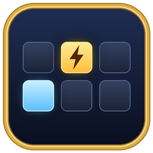

<p align="center">
  
</p>

# StreamDeck WoW — Léeme

Controla **World of Warcraft: Forever** desde una **Stream Deck**: cada tecla lanza un hechizo, usa un objeto o ejecuta una macro, y muestra su icono. Lo que hace cada tecla se configura **dentro del juego**, arrastrando hechizos a una ventana, y la Stream Deck se actualiza sola.

El proyecto tiene tres piezas que trabajan juntas:

| Pieza | Qué es | Dónde está |
|---|---|---|
| **Addon StreamDeck WoW** | Addon de WoW que convierte los atajos de la Stream Deck en hechizos, objetos o macros | La raíz de este repositorio |
| **Plugin WoW Deck** | Plugin de Stream Deck que pinta cada tecla con el icono correcto y envía el atajo al pulsarla | [`StreamDeck/com.fsegado.wowdeck.sdPlugin`](StreamDeck/com.fsegado.wowdeck.sdPlugin) |
| **Perfil «WoW Forever»** | Perfil de Stream Deck + que se activa solo al poner WoW en primer plano | Se genera con [`StreamDeck/profile`](StreamDeck/profile) |

> **Estado:** versión **0.1.0**, en pruebas. Probado con WoW Forever 1.60.1 (la lista de addons lo acepta sin marcarlo como incompatible) y Stream Deck 7.6.1. Todo el flujo está probado con una API del juego simulada; la prueba completa dentro del mundo está pendiente.

---

## Índice

1. [La idea en una imagen](#1-la-idea-en-una-imagen)
2. [Por qué está hecho así](#2-por-qué-está-hecho-así)
3. [Cómo funciona, paso a paso](#3-cómo-funciona-paso-a-paso)
4. [El addon por dentro](#4-el-addon-por-dentro)
5. [El plugin por dentro](#5-el-plugin-por-dentro)
6. [El contrato entre addon y plugin](#6-el-contrato-entre-addon-y-plugin)
7. [Los atajos de teclado](#7-los-atajos-de-teclado)
8. [El perfil de Stream Deck](#8-el-perfil-de-stream-deck)
9. [Requisitos](#9-requisitos)
10. [Instalación](#10-instalación)
11. [Uso](#11-uso)
12. [Huecos por defecto](#12-huecos-por-defecto)
13. [Estructura del proyecto](#13-estructura-del-proyecto)
14. [Desarrollo](#14-desarrollo)
15. [Diagnóstico y solución de problemas](#15-diagnóstico-y-solución-de-problemas)
16. [Limitaciones conocidas](#16-limitaciones-conocidas)

---

## 1. La idea en una imagen

```
                 ┌──────────────────────── WoW Forever ───────────────────────┐
                 │                                                            │
  Pulsas una     │   Addon StreamDeck WoW                                     │
  tecla de la    │   ───────────────────                                      │
  Stream Deck    │   Ctrl+Alt+Mayús+F3  ──(override binding)──>  Llamar a     │
       │         │                                               mascota      │
       ▼         │                                                            │
 ┌───────────┐   │   /sdeck config ──> guarda los huecos en StreamDeckWoWChar │
 │  Plugin   │   │                         │                                  │
 │  WoW Deck │   └─────────────────────────┼──────────────────────────────────┘
 │           │                             │  /reload, cerrar sesión o salir:
 │ envía     │──── Ctrl+Alt+Mayús+F3 ────> │  WoW escribe el archivo
 │ el atajo  │     (teclado de Windows)    ▼
 │           │                  WTF\...\SavedVariables\StreamDeckWoW.lua
 │ pinta la  │<──── lee el archivo cada 1,5 s ─────┘
 │ tecla     │
 └───────────┘──── descarga el icono de Wowhead (una vez, con caché)
```

- **De la Stream Deck al juego** la comunicación es por **teclado**: el plugin pulsa un atajo y el addon decide qué hace ese atajo.
- **Del juego a la Stream Deck** es por **archivo**: el addon deja en sus *SavedVariables* qué hay en cada hueco y el plugin lo lee.

---

## 2. Por qué está hecho así

Cada decisión responde a una limitación concreta del juego o de Stream Deck.

**WoW no deja que un programa externo lance hechizos.** Es intencionado, para impedir bots. Lo único que puede hacer la Stream Deck es pulsar teclas, como un teclado. Por eso el plugin envía un atajo y la lógica de «qué hechizo es» vive dentro del juego, en el addon.

**Un addon no puede abrir archivos ni conexiones de red.** Está encerrado en el juego. Lo único que puede sacar fuera son sus **SavedVariables**: variables que WoW guarda en disco al hacer `/reload`, al cerrar sesión o al salir. Ese archivo es el canal del juego hacia la Stream Deck.

**Un plugin de Stream Deck no puede pulsar teclas mediante la aplicación ni cambiar el icono de las acciones propias de Elgato.** El SDK solo permite al plugin cambiar la imagen, el título y el estado de *sus* teclas ([referencia del SDK](https://docs.elgato.com/streamdeck/sdk/references/websocket/plugin)). Si queremos que una tecla cambie de icono sola, esa tecla tiene que ser del plugin, y entonces también tiene que ser el plugin quien envíe la pulsación.

**Sin el plugin todo seguiría funcionando en el juego**: bastaría con teclas de atajo normales de Stream Deck que envíen `Ctrl+Alt+Mayús+F1…F12`. Lo que aporta el plugin es que los iconos y nombres de las teclas reflejen lo configurado en el juego, que las habilidades que aún no tienes se vean en gris y que un único perfil sirva para todos tus personajes.

---

## 3. Cómo funciona, paso a paso

### 3.1. Al entrar con un personaje

1. WoW carga los archivos del addon en el orden del [`.toc`](StreamDeckWoW.toc) y recupera sus SavedVariables (`StreamDeckWoWChar`) del disco.
2. Con el evento `PLAYER_LOGIN`, el addon averigua la clase del personaje (por su nombre interno en inglés, `HUNTER`, que no depende del idioma).
3. Para cada uno de los 12 huecos decide qué asignar ([`Core/Slots.lua`](Core/Slots.lua)):
   - si lo has configurado tú, lo tuyo;
   - si no, el valor por defecto de tu clase o, si no lo hay, el común ([`Defaults/`](Defaults));
   - de una lista de hechizos, el primero que conozcas; de una lista de objetos, el primero que lleves en las bolsas (así la tecla de poción usa siempre la mejor que tengas).
4. Asigna cada hueco a su atajo con **override bindings** ([`Core/Bindings.lua`](Core/Bindings.lua)). El hueco 3 queda como `ALT-CTRL-SHIFT-F3 → Llamar a mascota`.
5. Guarda una **foto** de los 12 huecos en `StreamDeckWoWChar.slots` (nombre, tipo, ID, icono, si está disponible) para el plugin.
6. Escribe en el chat un resumen: *«7 de 12 teclas listas»*.

A partir de ahí recalcula solo cuando hace falta: al aprender o perder hechizos (`SPELLS_CHANGED`), al cambiar las bolsas (`BAG_UPDATE_DELAYED`) o las macros (`UPDATE_MACROS`). Esos eventos llegan en ráfagas, así que se agrupan en una sola actualización medio segundo después.

### 3.2. Al pulsar una tecla de la Stream Deck

1. Stream Deck avisa al plugin con el evento `keyDown` de esa tecla.
2. El plugin mira qué hueco representa la tecla (un ajuste guardado en el perfil, `{ "slot": 3 }`).
3. Pide al proceso auxiliar ([`helper.ps1`](StreamDeck/com.fsegado.wowdeck.sdPlugin/bin/helper.ps1)) que pulse `Ctrl + Alt + Mayús + F3`.
4. El auxiliar comprueba qué modificadores estás pulsando ya con la mano, pulsa solo los que faltan más la F3, la mantiene 30 ms y suelta lo que pulsó él ([`WowDeckKeys.cs`](StreamDeck/com.fsegado.wowdeck.sdPlugin/bin/native/WowDeckKeys.cs)).
5. Windows entrega la pulsación a la ventana con el foco: WoW.
6. WoW encuentra el override binding del addon y lanza **Llamar a mascota**.

La pulsación es idéntica a la de un teclado: una pulsación, una acción.

### 3.3. Al cambiar un hueco en el juego

1. Abres la ventana con `/sdeck config` ([`UI/ConfigWindow.lua`](UI/ConfigWindow.lua)).
2. Arrastras un hechizo del libro, un objeto de las bolsas o una macro a un hueco ([`UI/SlotButton.lua`](UI/SlotButton.lua)). El addon lee qué llevas en el cursor y lo guarda en `StreamDeckWoWChar.custom[n]`.
3. El cambio **funciona en el juego al momento**: el addon reasigna los atajos.
4. Para que la Stream Deck lo vea, pulsas **Actualizar Stream Deck** (hace `/reload`). WoW escribe las SavedVariables en disco.
5. El plugin, que comprueba ese archivo cada 1,5 segundos, ve que ha cambiado, lo lee y repinta las teclas.
6. Si un icono no está en su caché, lo pide a Wowhead: primero el nombre del icono a partir del ID del hechizo u objeto y después la imagen. Lo guarda en disco y no vuelve a descargarlo.

### 3.4. Durante el combate

WoW bloquea los cambios de atajos en combate. Si algo cambia en mitad de una pelea (te bebes la última poción, por ejemplo), el addon lo deja pendiente y lo aplica al salir de combate (`PLAYER_REGEN_ENABLED`). Las teclas siguen funcionando con lo que tenían asignado.

### 3.5. Con varios personajes

Cada personaje guarda su configuración en su propio archivo de SavedVariables. El plugin siempre muestra el **más reciente**, es decir, el del último personaje con el que has entrado. Por eso basta un perfil de Stream Deck para todas las clases: al cambiar de personaje, las teclas cambian solas.

---

## 4. El addon por dentro

Todos los archivos del addon reciben la misma tabla privada (`local _, ns = ...`), que hace de espacio de nombres compartido sin crear variables globales que puedan chocar con otros addons. Cada módulo se cuelga de ella (`ns.Slots`, `ns.Bindings`…) y usa los que se han cargado antes.

| Archivo | Responsabilidad |
|---|---|
| [`Core/Constants.lua`](Core/Constants.lua) | Todos los valores fijos: número de huecos, modificadores del atajo, eventos, colores, medidas de la ventana |
| [`Core/Util.lua`](Core/Util.lua) | Utilidades genéricas, reutilizables en cualquier addon: suscripción a eventos, mensajes entre módulos, *debounce*, ejecutar fuera de combate, escribir en el chat |
| [`Core/Keys.lua`](Core/Keys.lua) | Traduce un hueco a su atajo (`ALT-CTRL-SHIFT-F3`) y a su texto legible (`Ctrl+Alt+Mayús+F3`) |
| [`Core/Api.lua`](Core/Api.lua) | Única puerta a la API del juego para hechizos, objetos, macros, cursor y metadatos. Prueba la API moderna (`C_Spell`, `C_Item`, `C_SpellBook`) y cae a la clásica si no existe |
| [`Core/Storage.lua`](Core/Storage.lua) | Único módulo que toca la variable guardada `StreamDeckWoWChar` |
| [`Defaults/Defaults.lua`](Defaults/Defaults.lua) | Registro de valores por defecto: comunes y por clase |
| [`Defaults/Common.lua`](Defaults/Common.lua) | Huecos comunes a todas las clases |
| [`Defaults/Classes/Hunter.lua`](Defaults/Classes/Hunter.lua) | Huecos del cazador |
| [`Core/Slots.lua`](Core/Slots.lua) | Qué hay en cada hueco: definición, resolución, foto para el plugin |
| [`Core/Bindings.lua`](Core/Bindings.lua) | Asigna los atajos y decide cuándo recalcular |
| [`UI/SlotButton.lua`](UI/SlotButton.lua) | Componente de botón de hueco: icono, arrastrar y soltar, tooltip |
| [`UI/ConfigWindow.lua`](UI/ConfigWindow.lua) | La ventana `/sdeck config` |
| [`Core/Commands.lua`](Core/Commands.lua) | Comandos `/sdeck` |

### Override bindings

Los atajos se asignan con `SetOverrideBinding*` y no con `SetBinding*`:

- `SetBinding` cambia **tus** atajos guardados (se sincronizan con el servidor) y el cambio se queda aunque desinstales el addon.
- `SetOverrideBinding` crea una capa temporal ligada a un *frame* del addon, con prioridad sobre los atajos normales. No se guarda en ningún sitio y desaparece al desactivar el addon.

Cada recálculo empieza de cero (`ClearOverrideBindings`) y asigna los 12 huecos: es más simple que calcular diferencias y, con 12 huecos, no cuesta nada.

Los hechizos se asignan **por nombre**, no por ID: con el nombre sin rango, WoW lanza siempre el rango más alto que conozcas, así que la tecla sigue valiendo al subir de nivel.

### Mensajes entre módulos

Los módulos no se llaman directamente cuando eso crearía dependencias circulares; se avisan con mensajes internos ([`Core/Util.lua`](Core/Util.lua)):

- `SLOT_CHANGED`: el jugador ha cambiado un hueco → `Bindings` recalcula.
- `SLOTS_UPDATED`: se han asignado los huecos → la ventana se redibuja y, la primera vez, se escribe el resumen en el chat.

### Tipos de entrada de un hueco

| Forma | Ejemplo | Comportamiento |
|---|---|---|
| `spells = { … }` | `{ 18260, 3413, 3102, 2550 }` | El primer hechizo que conozcas (útil para los rangos de las profesiones) |
| `items = { … }` | `{ 13446, 3928, … }` | El primer objeto que lleves en las bolsas, de mejor a peor |
| `names = { … }` | `{ "Campamento", "Acampar" }` | Hechizos por nombre, cuando aún no se conoce su ID |
| `{ kind = "spell", id = … }` | arrastrado por el jugador | Siempre ese hechizo |
| `{ kind = "item", id = … }` | arrastrado por el jugador | Siempre ese objeto |
| `{ kind = "macro", name = … }` | arrastrado por el jugador | Esa macro, guardada por nombre (el índice cambia al borrar otras) |

---

## 5. El plugin por dentro

Stream Deck lanza el plugin con su propio Node.js (versión 20, indicada en el [`manifest.json`](StreamDeck/com.fsegado.wowdeck.sdPlugin/manifest.json)) y le pasa por argumentos un puerto local. Todo lo demás es un **WebSocket** con mensajes JSON:

- **Stream Deck → plugin:** `willAppear` (una tecla se muestra), `willDisappear`, `keyDown`, `didReceiveSettings`…
- **Plugin → Stream Deck:** `setImage`, `setTitle`, `showAlert`…

Cada tecla visible tiene un `context`, un identificador opaco con el que se le dirigen los mensajes.

[`bin/plugin.js`](StreamDeck/com.fsegado.wowdeck.sdPlugin/bin/plugin.js) solo crea las piezas y las conecta. Las piezas están en `bin/lib/`:

| Archivo | Responsabilidad | ¿Específico de WoW? |
|---|---|---|
| [`constants.js`](StreamDeck/com.fsegado.wowdeck.sdPlugin/bin/lib/constants.js) | Rutas, tiempos, códigos de tecla, URLs; lee la versión del `manifest.json` | — |
| [`log.js`](StreamDeck/com.fsegado.wowdeck.sdPlugin/bin/lib/log.js) | Registro a archivo y a la salida estándar | No |
| [`streamdeck.js`](StreamDeck/com.fsegado.wowdeck.sdPlugin/bin/lib/streamdeck.js) | Conexión con la aplicación de Stream Deck | No |
| [`helper.js`](StreamDeck/com.fsegado.wowdeck.sdPlugin/bin/lib/helper.js) | Gestiona el proceso auxiliar de PowerShell | No |
| [`luatable.js`](StreamDeck/com.fsegado.wowdeck.sdPlugin/bin/lib/luatable.js) | Lee el formato Lua de las SavedVariables | No |
| [`images.js`](StreamDeck/com.fsegado.wowdeck.sdPlugin/bin/lib/images.js) | Imágenes para las teclas (archivos y SVG generados) | No |
| [`text.js`](StreamDeck/com.fsegado.wowdeck.sdPlugin/bin/lib/text.js) | Títulos en dos líneas | No |
| [`wow.js`](StreamDeck/com.fsegado.wowdeck.sdPlugin/bin/lib/wow.js) | Localiza WoW Forever y sus SavedVariables | Sí |
| [`watcher.js`](StreamDeck/com.fsegado.wowdeck.sdPlugin/bin/lib/watcher.js) | Avisa cuando WoW reescribe las SavedVariables | Sí |
| [`icons.js`](StreamDeck/com.fsegado.wowdeck.sdPlugin/bin/lib/icons.js) | Iconos de Wowhead con caché en disco | Sí |
| [`slotAction.js`](StreamDeck/com.fsegado.wowdeck.sdPlugin/bin/lib/slotAction.js) | La acción «Hueco WoW»: pintar y pulsar | Sí |

### El proceso auxiliar

Node no puede simular teclado sin un módulo nativo compilado para cada versión. En su lugar, el plugin arranca **una vez** un PowerShell ([`helper.ps1`](StreamDeck/com.fsegado.wowdeck.sdPlugin/bin/helper.ps1)) que compila un poco de C# ([`native/WowDeckKeys.cs`](StreamDeck/com.fsegado.wowdeck.sdPlugin/bin/native/WowDeckKeys.cs)) y se queda escuchando órdenes por la entrada estándar:

```
KEYS 17,18,16,114          → pulsa Ctrl+Alt+Mayús+F3      → responde "OK KEYS"
DIM entrada.jpg|salida.png → guarda el icono en gris      → responde "OK DIM"
```

Arrancarlo cuesta un segundo; después cada orden tarda milisegundos. Si el proceso muere, el plugin lo relanza.

### Cómo pinta cada tecla

| Situación | Imagen | Título |
|---|---|---|
| Todavía no has entrado con el addon | Texto «F*n*» | — |
| Hueco vacío | Fondo liso | — |
| Hechizo u objeto disponible | Icono de Wowhead | Nombre corto |
| Aún no lo tienes (no aprendido, sin pociones) | Icono en gris oscuro | Nombre corto |
| Macro o habilidad sin ID conocido | Texto «Macro» o «F*n*» | Nombre |
| Sin conexión y sin el icono en caché | Texto «F*n*» | Nombre corto |

### Por qué consulta el archivo en vez de vigilarlo

Cada 1,5 segundos hace un `stat` del archivo (coste inapreciable) en lugar de usar `fs.watch`, que en Windows puede disparar varias veces o perder cambios según cómo escriba el archivo el juego.

---

## 6. El contrato entre addon y plugin

Addon y plugin solo comparten dos cosas, y si se cambian hay que cambiarlas en los dos lados.

### 6.1. Los atajos

| Lado | Dónde | Valor |
|---|---|---|
| Addon | `Const.KEY_MODIFIERS` en [`Core/Constants.lua`](Core/Constants.lua) | `"ALT-CTRL-SHIFT-"` |
| Plugin | `MODIFIERS` en [`bin/lib/constants.js`](StreamDeck/com.fsegado.wowdeck.sdPlugin/bin/lib/constants.js) | `[VK.CTRL, VK.MENU, VK.SHIFT]` |

Hueco *n* = tecla F*n* (F1 a F12).

### 6.2. El archivo de SavedVariables

Ruta (una por personaje):

```
World of Warcraft\_forever_\WTF\Account\<CUENTA>\<Reino>\<Personaje>\SavedVariables\StreamDeckWoW.lua
```

Contenido, tal como lo escribe WoW:

```lua
StreamDeckWoWChar = {
    ["class"] = "HUNTER",
    ["updated"] = 1762200000,          -- última actualización (segundos desde 1970)
    ["custom"] = {                      -- lo que ha cambiado el jugador
        [9] = { ["kind"] = "macro", ["name"] = "Trampa" },
        [11] = false,                   -- vaciado a propósito
    },
    ["slots"] = {                       -- la foto que lee el plugin
        {
            ["active"] = true,          -- ¿se puede usar ahora?
            ["kind"] = "item",          -- "spell" | "item" | "macro"
            ["id"] = 6948,              -- ID para descargar el icono
            ["icon"] = 134414,          -- ID de archivo de icono del juego
            ["name"] = "Piedra de hogar",
            ["short"] = "Hogar",        -- texto de la tecla
        }, -- [1]
        -- ... hasta [12]; un hueco vacío es { ["active"] = false, ["empty"] = true }
    },
}
```

El plugin solo lee `slots`. `custom` es para el propio addon.

---

## 7. Los atajos de teclado

**¿Por qué `Ctrl+Alt+Mayús+F1…F12`?** Nadie los teclea a mano: los pulsa la Stream Deck. Usar los tres modificadores a la vez da una combinación que prácticamente ningún programa ni el propio juego usan, así que no choca con tus atajos.

**¿Y Alt+F4 en el hueco 4?** Comprobado: con Ctrl pulsado, Windows no trata `Ctrl+Alt+Mayús+F4` como «cerrar ventana».

**¿Y si estoy manteniendo Mayús con la mano?** El auxiliar lo detecta (`GetAsyncKeyState`): no pulsa ni suelta los modificadores que ya mantienes. Si lo hiciera, el juego creería que has soltado tu tecla aunque la sigas pulsando.

**¿Es seguro con las normas de Blizzard?** Cada pulsación de la Stream Deck es una tecla y lanza una sola habilidad, igual que cualquier teclado con teclas macro. Lo que Blizzard sanciona es automatizar (varias acciones por pulsación o jugar sin ti).

---

## 8. El perfil de Stream Deck

El perfil **«WoW Forever»** para Stream Deck + tiene dos páginas de 8 teclas y 4 diales. Es un *smart profile*: está vinculado al `Wow.exe` de WoW Forever, así que Stream Deck lo activa al poner el juego en primer plano y vuelve al perfil predeterminado al salir.

```
Página 1                                   Página 2
┌───────┬───────┬───────┬───────┐          ┌─────────┬──────────┬────────┬────────┐
│ Hueco │ Hueco │ Hueco │ Hueco │          │Mochilas │ Hueco 12 │ Hueco 8│ Hueco 9│
│   1   │   2   │   3   │   4   │          │ (Mayús+B)│          │        │        │
├───────┼───────┼───────┼───────┤          ├─────────┼──────────┼────────┼────────┤
│ Hueco │ Hueco │ Hueco │   ›   │          │ Hueco 10│ Hueco 11 │ Reposo │   ‹    │
│   5   │   6   │   7   │       │          │         │          │  (X)   │        │
└───────┴───────┴───────┴───────┘          └─────────┴──────────┴────────┴────────┘

Diales (iguales en las dos páginas): girar ⟲ / girar ⟳ / pulsar
  Objetivo   enemigo anterior / siguiente / asistir (F)
  Mascota    quieto / seguir / atacar           (barra de mascota del juego)
  Actitud    pasivo / agresivo / defensivo      (barra de mascota del juego)
  Chat/Mapa  subir chat / bajar chat / mapa (M)
```

Las teclas «Hueco» son del plugin. Mochilas, Reposo, las flechas y los diales son acciones normales de Stream Deck con atajos que el juego trae por defecto, así que no pasan por el addon. Los diales de mascota solo hacen algo con clases que tienen mascota.

El perfil se genera a partir de un *layout* escrito como datos ([`layouts/wow_forever.py`](StreamDeck/profile/layouts/wow_forever.py)). Lo que depende de cada equipo, como el número de serie de la Stream Deck o la ruta de WoW, no está en el repositorio: se detecta al generar el perfil (ver [§14.3](#143-generar-el-perfil-de-stream-deck)).

---

## 9. Requisitos

| Para | Necesitas |
|---|---|
| Jugar | **World of Warcraft: Forever** (cliente 1.60.1 o posterior) |
| La Stream Deck | **Stream Deck +** (el perfil está pensado para sus 8 teclas y 4 diales) y la aplicación **Stream Deck 7.6** o posterior, en **Windows 10/11** |
| Instalar el plugin desde el código | **npm**, para instalar la única dependencia (`ws`) |
| Generar el perfil o el icono | **Python 3** con **Pillow** (`pip install pillow`) |

El addon funciona por su cuenta sin Stream Deck: cualquier programa o teclado que envíe `Ctrl+Alt+Mayús+F1…F12` sirve.

---

## 10. Instalación

### 10.1. Addon

Clona o copia este repositorio como carpeta `StreamDeckWoW` dentro de los addons de Forever:

```
World of Warcraft\_forever_\Interface\AddOns\StreamDeckWoW\StreamDeckWoW.toc
```

El nombre de la carpeta tiene que coincidir con el del `.toc`. La subcarpeta `StreamDeck/` (plugin y generadores) no molesta: WoW solo carga los archivos que lista el `.toc`.

En la pantalla de personajes, botón **AddOns**, comprueba que **StreamDeck WoW** está activado.

### 10.2. Plugin

1. Instala la dependencia del plugin:

   ```bash
   cd StreamDeck/com.fsegado.wowdeck.sdPlugin/bin
   npm ci --omit=dev
   ```

2. Pon la carpeta `com.fsegado.wowdeck.sdPlugin` en `%APPDATA%\Elgato\StreamDeck\Plugins\`. Para desarrollo es más cómodo un **enlace de directorio**, que no necesita permisos de administrador y mantiene el plugin al día con el repositorio:

   ```bash
   mklink /J "%APPDATA%\Elgato\StreamDeck\Plugins\com.fsegado.wowdeck.sdPlugin" "<ruta al repo>\StreamDeck\com.fsegado.wowdeck.sdPlugin"
   ```

   (`mklink` es un comando de `cmd`.)

3. Reinicia la aplicación de Stream Deck. En la lista de acciones aparecerá la categoría **WoW Forever** con la acción **Hueco WoW**.

El plugin busca WoW Forever solo: primero dentro de la ruta en la que está instalado (si vive dentro de `_forever_\Interface\AddOns`) y después en las rutas habituales de cada unidad. Para forzar otra ruta, define la variable de entorno `WOWDECK_FOREVER`.

### 10.3. Perfil

Puedes montarlo a mano en la aplicación de Stream Deck: arrastra **Hueco WoW** a cada tecla y elige su número en el panel de ajustes. O puedes generarlo ya montado ([§14.3](#143-generar-el-perfil-de-stream-deck)).

---

## 11. Uso

### Comandos

| Comando | Qué hace |
|---|---|
| `/sdeck` | Lista los 12 huecos: qué tiene asignado cada uno y, en rojo, lo que todavía no tienes |
| `/sdeck config` | Abre o cierra la ventana de configuración |
| `/sdeck ayuda` | Versión del addon y lista de comandos |

### Ventana de configuración

<p align="center"><code>/sdeck config</code></p>

- **Arrastra** un hechizo del libro, un objeto de las bolsas o una macro a un hueco. También vale coger con un clic y soltar con otro, como en las barras de acción.
- **Clic derecho:** vuelve al valor por defecto.
- **Mayús + clic derecho:** deja el hueco vacío.
- Nombre en **dorado** = personalizado; en gris = valor por defecto; icono en gris = todavía no lo tienes.
- **Actualizar Stream Deck** recarga la interfaz para que WoW guarde el archivo y la Stream Deck muestre los iconos nuevos.

Los cambios funcionan en el juego **al momento**; recargar solo hace falta para que la Stream Deck los vea.

---

## 12. Huecos por defecto

| Hueco | Atajo | Todas las clases | Cazador |
|---|---|---|---|
| 1 | Ctrl+Alt+Mayús+F1 | Piedra de hogar | |
| 2 | Ctrl+Alt+Mayús+F2 | | Aspecto del guepardo |
| 3 | Ctrl+Alt+Mayús+F3 | | Llamar a mascota |
| 4 | Ctrl+Alt+Mayús+F4 | | Revivir mascota |
| 5 | Ctrl+Alt+Mayús+F5 | | Alimentar mascota |
| 6 | Ctrl+Alt+Mayús+F6 | La mejor poción de curación que lleves | |
| 7 | Ctrl+Alt+Mayús+F7 | La mejor poción de maná que lleves | |
| 8 | Ctrl+Alt+Mayús+F8 | | Cocina |
| 9 | Ctrl+Alt+Mayús+F9 | | Peletería |
| 10 | Ctrl+Alt+Mayús+F10 | | Buscar hierbas |
| 11 | Ctrl+Alt+Mayús+F11 | | Alquimia |
| 12 | Ctrl+Alt+Mayús+F12 | Campamento (sistema de acampada de Forever) | |

Los valores de una clase tienen prioridad sobre los comunes con el mismo número. Lo que configures en el juego tiene prioridad sobre todo.

---

## 13. Estructura del proyecto

```
StreamDeckWoW/                         ← carpeta del addon (raíz del repositorio)
├── StreamDeckWoW.toc                  manifiesto del addon: metadatos y orden de carga
├── Core/                              núcleo del addon
│   ├── Constants.lua                  valores fijos
│   ├── Util.lua                       utilidades genéricas
│   ├── Keys.lua                       atajos de cada hueco
│   ├── Api.lua                        acceso a la API del juego
│   ├── Storage.lua                    SavedVariables
│   ├── Slots.lua                      lógica de los huecos
│   ├── Bindings.lua                   asignación de atajos
│   └── Commands.lua                   comandos /sdeck
├── Defaults/                          valores por defecto (solo datos)
│   ├── Defaults.lua                   registro
│   ├── Common.lua                     todas las clases
│   └── Classes/Hunter.lua             cazador
├── UI/                                interfaz
│   ├── SlotButton.lua                 botón de hueco
│   └── ConfigWindow.lua               ventana /sdeck config
├── Media/Icon.tga                     icono del addon (lista de addons y chat)
└── StreamDeck/                        todo lo de Stream Deck (WoW no lo carga)
    ├── com.fsegado.wowdeck.sdPlugin/  el plugin
    │   ├── manifest.json              manifiesto: nombre, versión, acción, Node
    │   ├── bin/plugin.js              punto de entrada
    │   ├── bin/lib/*.js               piezas del plugin (ver §5)
    │   ├── bin/helper.ps1             proceso auxiliar: teclas e imágenes
    │   ├── bin/native/WowDeckKeys.cs  pulsaciones de teclado (C#)
    │   ├── ui/slot.html               panel de ajustes de la tecla
    │   └── imgs/                      iconos del plugin
    ├── profile/                       generador del perfil de Stream Deck
    │   ├── make_profile.py            punto de entrada
    │   ├── layouts/wow_forever.py     el perfil, como datos
    │   ├── lib/*.py                   formato de perfiles, acciones, imágenes…
    │   └── local.example.json         plantilla de configuración del equipo
    └── branding/                      generador del icono del proyecto
        ├── make_icons.py
        ├── draw.py
        └── constants.py               colores y medidas
```

---

## 14. Desarrollo

### 14.1. Añadir una clase

1. Crea `Defaults/Classes/<Clase>.lua` siguiendo el modelo de [`Hunter.lua`](Defaults/Classes/Hunter.lua):

   ```lua
   local _, ns = ...

   ns.Defaults.RegisterClass("WARRIOR", {
       [2] = { short = "Grito", spells = { 6673 } },
       -- ...
   })
   ```

   La clave es el nombre interno de la clase en inglés: `WARRIOR`, `PALADIN`, `HUNTER`, `ROGUE`, `PRIEST`, `SHAMAN`, `MAGE`, `WARLOCK`, `DRUID`.

2. Añade la línea `Defaults\Classes\<Clase>.lua` al `.toc`, junto a la del cazador.

Los IDs de hechizos y objetos de Forever se consultan en [Wowhead (Forever)](https://www.wowhead.com/forever). Para las profesiones, lista todos los rangos del más alto al más bajo.

### 14.2. Cambiar los atajos

Cambia los **dos** lados del contrato ([§6.1](#61-los-atajos)): `Const.KEY_MODIFIERS` y `Const.KEY_MODIFIERS_LABEL` en el addon y `MODIFIERS` en el plugin.

### 14.3. Generar el perfil de Stream Deck

Con la aplicación de Stream Deck **cerrada** (si está abierta, sobrescribe los cambios al salir):

```bash
python StreamDeck/profile/make_profile.py wow_forever "%APPDATA%\Elgato\StreamDeck\ProfilesV3"
```

- `--uuid <UUID>` reemplaza un perfil existente en lugar de crear otro.
- El **dispositivo** se detecta a partir de los perfiles que ya tienes en la aplicación (hace falta al menos uno de la Stream Deck +), y la **ruta de WoW**, buscando en las rutas de instalación habituales.
- Si la detección falla, copia [`local.example.json`](StreamDeck/profile/local.example.json) como `local.json` y rellena lo que falte. `local.json` no se sube al repositorio.
- El generador escribe el formato **ProfilesV3** (Stream Deck 7.6 o posterior).
- Los iconos de WoW que usa el layout para las teclas fijas no están en el repositorio, porque son arte de Blizzard. Descárgalos como `.jpg` en `StreamDeck/profile/icons/` desde `https://wow.zamimg.com/images/wow/icons/large/<nombre>.jpg`: `inv_misc_bag_08`, `inv_misc_map02`, `ability_hunter_snipershot`, `ability_hunter_pet_wolf`, `ability_hunter_beastmastery`. Los de los huecos no hacen falta: el plugin los descarga solo.

Para crear otro perfil, añade un archivo en `layouts/` con el vocabulario de [`lib/spec.py`](StreamDeck/profile/lib/spec.py): `slot(n)`, `hotkey(...)`, `next_page()`, `prev_page()`, `switch_profile(...)`, `dial(...)`.

### 14.4. Regenerar el icono

Los colores y medidas están en [`branding/constants.py`](StreamDeck/branding/constants.py). Para generar todos los tamaños (addon y plugin) y una lámina de revisión:

```bash
python StreamDeck/branding/make_icons.py --preview revision.png
```

### 14.5. Versión

Cada pieza tiene un único sitio donde se escribe su versión; el resto del código la lee de ahí:

| Pieza | Dónde |
|---|---|
| Addon | `## Version` en [`StreamDeckWoW.toc`](StreamDeckWoW.toc) |
| Plugin | `Version` en [`manifest.json`](StreamDeck/com.fsegado.wowdeck.sdPlugin/manifest.json) |

`## Interface: 16001` en el `.toc` es la versión de interfaz de WoW Forever 1.60.1. Si una actualización del juego la cambia, el addon aparecerá como incompatible; el valor nuevo se obtiene en el juego con `/dump select(4, GetBuildInfo())`.

---

## 15. Diagnóstico y solución de problemas

### Dónde mirar

| Qué | Dónde |
|---|---|
| Estado de las teclas en el juego | `/sdeck` |
| Errores de Lua | Actívalos con `/console scriptErrors 1` |
| Registro del plugin | `%APPDATA%\WoWDeck\plugin.log` |
| Registro del plugin según Stream Deck | `%APPDATA%\Elgato\StreamDeck\logs\com.fsegado.wowdeck0.log` |
| Caché de iconos | `%APPDATA%\WoWDeck\icons\` (se puede borrar sin problema) |
| Datos que lee el plugin | `WTF\Account\...\SavedVariables\StreamDeckWoW.lua` |

### Problemas habituales

**Una tecla de la Stream Deck no hace nada en el juego.**
Mira `/sdeck`: si ese hueco sale en rojo, todavía no tienes lo que tiene asignado. Si sale bien, comprueba que el foco está en la ventana de WoW y que no estás escribiendo en el chat.

**Las teclas de la Stream Deck muestran «F1», «F2»…**
El plugin aún no ha encontrado datos: entra con un personaje con el addon activado y haz `/reload` (o sal del juego) para que WoW escriba el archivo.

**He cambiado un hueco y la Stream Deck no lo refleja.**
WoW solo escribe el archivo al recargar, cerrar sesión o salir. Pulsa **Actualizar Stream Deck** en la ventana o escribe `/reload`.

**Ninguna tecla funciona, ni las de atajos normales.**
Si WoW (o Battle.net) se ejecuta **como administrador**, Windows bloquea las pulsaciones que llegan de programas sin esos permisos. No marques WoW para ejecutarse como administrador.

**«Campamento» sale en rojo aunque tengo la habilidad.**
Su nombre exacto en el cliente puede no coincidir con los que prueba el addon. Arrástrala al hueco 12 desde el libro de hechizos con `/sdeck config`.

**El perfil no cambia solo al entrar o salir de WoW.**
Stream Deck activa el perfil cuando la ventana del juego coge el foco, y vuelve al perfil marcado como **predeterminado** en la aplicación cuando otra ventana lo coge. Asegúrate de tener un perfil predeterminado y de usar Stream Deck 7.6 o posterior.

---

## 16. Limitaciones conocidas

- **La Stream Deck se actualiza al recargar**, no en tiempo real: no puede mostrar enfriamientos, cargas ni si la mascota está fuera. El único canal del juego hacia fuera es el archivo de SavedVariables, que WoW escribe al recargar, cerrar sesión o salir.
- **En combate no se reasignan atajos** (lo impide el juego): los cambios esperan al final del combate.
- **Solo Windows.** El envío de teclas usa la API de Windows.
- **El perfil está pensado para la Stream Deck +.** El plugin y el addon funcionan con cualquier modelo, pero las páginas y los diales del perfil generado son los de la Stream Deck +.
- **Las teclas fijas del perfil** (Mochilas, Reposo, flechas y diales) usan la acción de atajos de Stream Deck, que no comprueba los modificadores que tengas pulsados con la mano.
